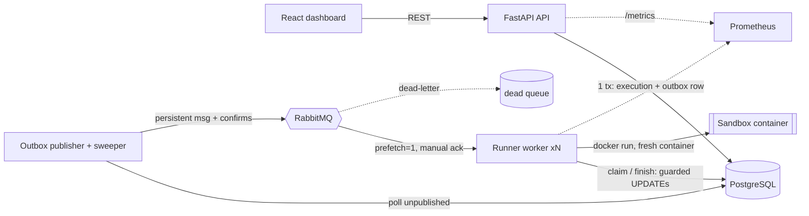

# Architecture

| Component | Code | Responsibility |
|---|---|---|
| API | `apps/api` | Validate, persist (execution + outbox in one transaction), serve status/history/cancel, health, metrics. **No Docker access, never runs user code.** |
| Outbox publisher | `apps/worker/codeforge_worker/publisher.py` | Publishes pending outbox rows to RabbitMQ (with publisher confirms and backoff) and runs the recovery sweeper. |
| Worker | `apps/worker/codeforge_worker/{main,processor,runner}.py` | Consume, claim, run in a container, record, ack. The only service with the Docker socket. |
| Shared | `packages/shared` | State machine, config, language registry, sandbox argument builder, store (all SQL), MQ topology. |

## Lifecycle
`QUEUED -> RUNNING -> SUCCEEDED | FAILED | TIMED_OUT | CANCELLED`, plus `QUEUED -> CANCELLED`,
`QUEUED -> FAILED` (queue exhausted) and `RUNNING -> QUEUED` (recovery requeue). Terminal states have no
outgoing transitions. The table lives in `states.py`; `SqlStore` asserts each transition it performs, and
every write is a compare-and-set `UPDATE ... WHERE status = <expected>`.

## Design decisions
- **Transactional outbox** instead of publishing from the API: a crash between "saved" and "published"
  cannot strand an execution (see failure-recovery.md).
- **Source/stdin over container stdin**, not bind mounts: no host paths are mounted, so the sandbox needs no
  volume and works the same when the worker itself runs in a container.
- **docker CLI via argv list** (no shell, no Docker SDK dependency); all flags generated by `sandbox.py`
  from validated server-side config.
- **Short transactions**: claim and finish are separate tiny transactions; nothing is held open while code runs.
- **Sync SQLAlchemy + pika BlockingConnection**: simple and adequate; the API runs sync routes in a threadpool.
- **Scaling**: `docker compose up -d --scale worker=N`. `prefetch=1` keeps load fair.
- **Duration** is container wall-clock time (includes container start-up), not CPU time.
